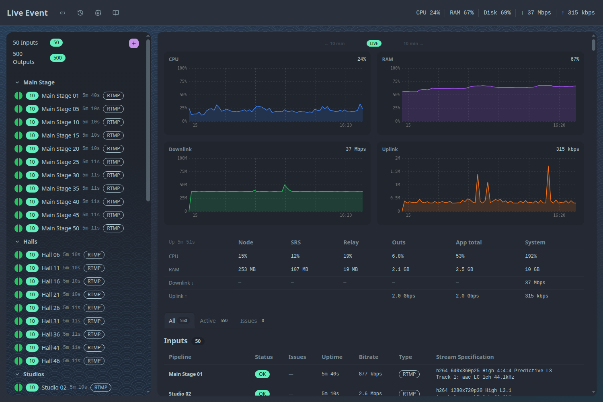
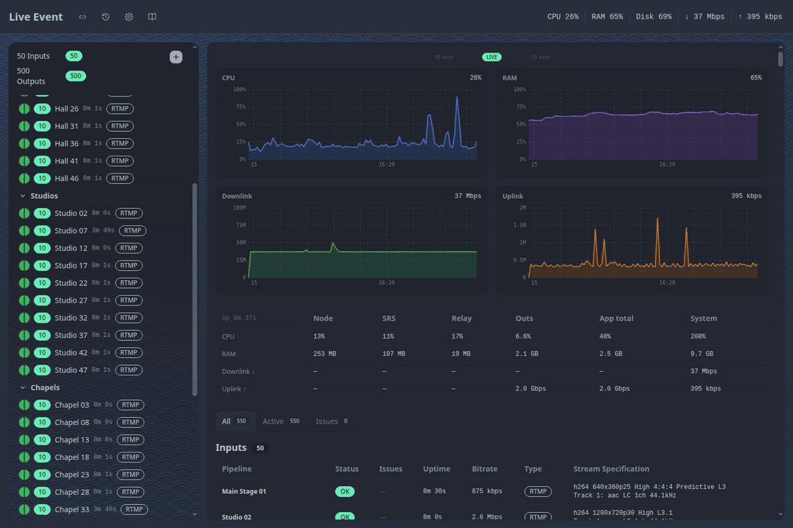
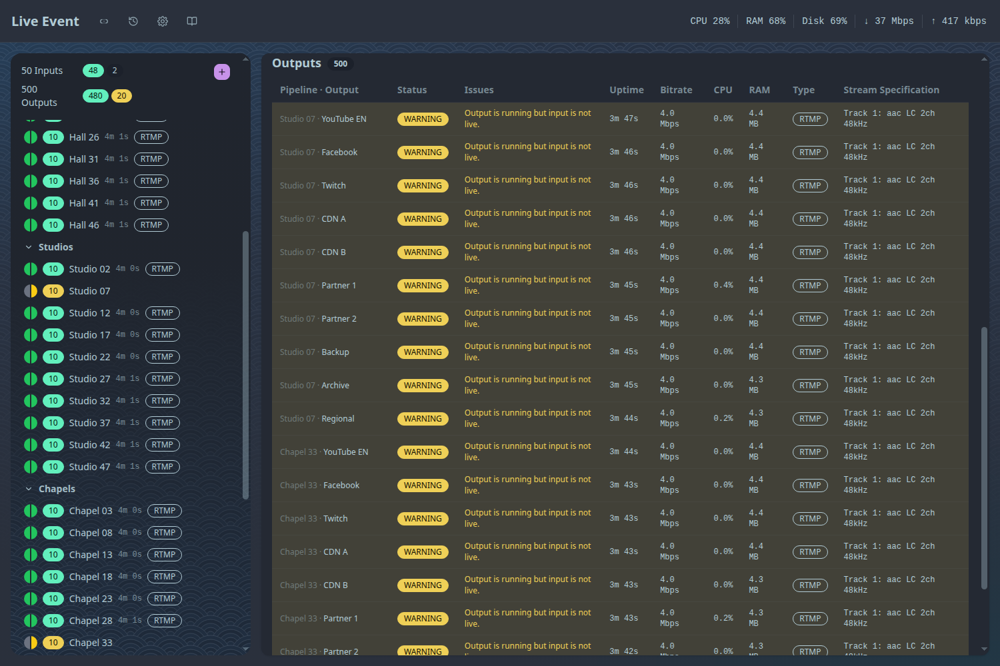
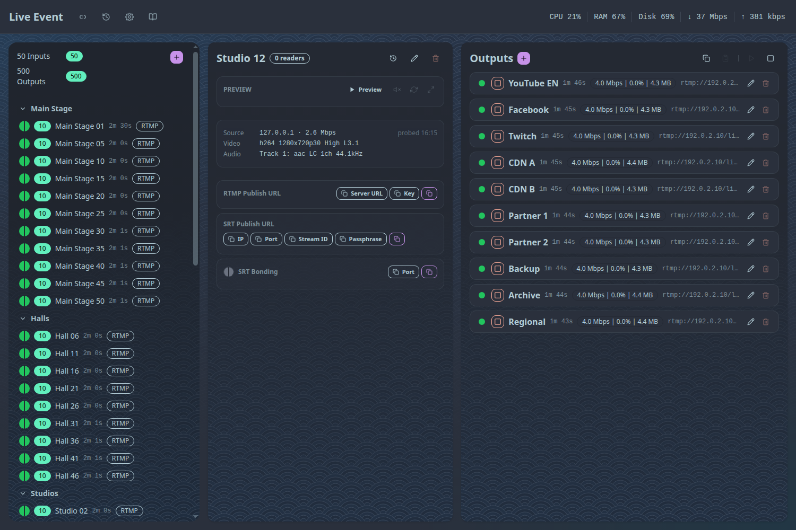

A long live event can mean dozens of inputs, each sent to a handful of destinations. Past a few
streams the question stops being "does it forward?" and becomes "can I still see what is
happening without the screen turning into noise?"

[Bunryu](https://github.com/live-miracles/bunryu) supports up to 50 inputs and 500 outputs on one
server. We had measured the server side of that, but never looked at the dashboard with the full
load on it. This post is that look.

## How we tested

We started the isolated test stack that ships with the repo, created 50 pipelines, and gave each one
10 outputs: 500 in total, the supported maximum. Every pipeline had a live input: a looped 720p clip
published over RTMP. All 500 outputs were running.

One thing to know before looking at the pictures: **the outputs are simulated.** Each one is a
stand-in for FFmpeg that reports progress and sends nothing over the network. The control plane,
SRS, the inputs and the dashboard are real, so this shows what the dashboard looks like and what it
costs the control plane. It does not show FFmpeg's own CPU and RAM, which our
[sizing page](https://live-miracles.github.io/projects/bunryu/docs/getting-started/sizing/) covers
separately. The machine was an 8-core laptop shared with other work.

## The overview

The left column is every pipeline, in groups (here Main Stage, Halls, Studios, Chapels and Plaza).
Each row has a status dot, its output count, its name, how long it has been up and its input
protocol. The totals at the top say "50 inputs, 500 outputs" with a green badge for each. To the
right are the host's CPU, RAM and network charts and a table of what each process costs.

Below that are two lists: every input, then every output.

## When something goes wrong

The useful test of a big dashboard is whether a problem shows up without hunting for it. We took two
of the 50 inputs offline and watched.

Within a few seconds:

- The totals changed to 48 live inputs and 480 healthy outputs, with a yellow 20 for the outputs that
  belong to the two dead inputs.
- The two pipelines turned yellow in their groups in the sidebar.
- The **Issues** tab narrowed the output list to those 20 outputs.

Each row says why: "Output is running but input is not live." The outputs were not failing, they
were waiting for an input that had gone, and that is what the dashboard told us.

## One pipeline at a time

Opening a pipeline shows its input, its publish URLs and its 10 outputs on one screen, each with
status, uptime, bitrate and memory. A group of ten outputs fits without scrolling, which is the
level you work at when you are adjusting one destination.

## What it costs

| Measure                                            | Result                                        |
| -------------------------------------------------- | --------------------------------------------- |
| Control plane with one dashboard open              | about 17% of one core, 251 MB of RAM          |
| `/api/health`, fetched every 5 s by each dashboard | 296 KB, 18 KB gzipped, about 30 ms to produce |
| Dashboard first render (headless Chrome, locally)  | 0.7 to 0.8 s (one run of four took 1.3 s)     |
| Overview page length                               | about 28,000 px, roughly 32 screens           |

These are the control plane's costs. A real 500-output server also runs 500 FFmpeg processes. Our
sizing page puts that at about 30 vCPUs and 17 to 30 GB of RAM at 8 Mbps per output.

## What is still awkward

Looking at it at this size also showed us what is not good yet:

- **There is no search box.** Finding one output by name or destination means opening its pipeline or
  scrolling. Groups help; search would help more.
- **The overview is one long page.** About 32 screens at 500 outputs. The Issues tab shortens it when
  something is wrong, but not when you just want to look around.
- **The "Outputs" heading keeps saying 500** when the Issues tab has narrowed the list to 20.
- **The Issues tab says "No input issues"** while two inputs are offline. The offline inputs are
  visible in the sidebar, the totals and through their outputs, but not in that list.

We have written the first one down under
[known issues](https://live-miracles.github.io/projects/bunryu/docs/operations/known-issues/).

## Takeaways

- **Test the interface at the capacity you claim.** We had the server numbers for 500 outputs and had
  never opened the dashboard at that size.
- **Show problems in the totals and the navigation, not only in a list.** Counting at the top and a
  colour in the sidebar mean you notice before you scroll.
- **Say what was simulated.** Without real FFmpeg processes this is a test of the dashboard and the
  control plane, and that is all it claims to be.
