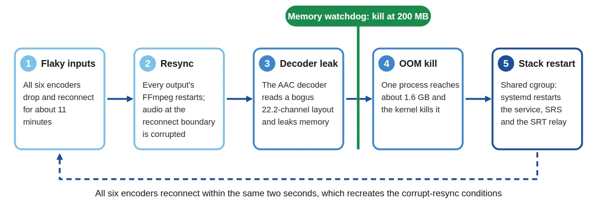

A live event cannot be restarted. When we built [Bunryu](https://github.com/live-miracles/bunryu), a
self-hosted server that forwards one live stream to many destinations, we assumed things would go wrong
and tried to keep each failure small. In July 2026 a single FFmpeg process showed us where that was not
true yet.

## The question

Someone looked at the dashboard and asked: "Output 1 has an error, output 2 doesn't. Why?"

Output 1's last error was `exit=SIGKILL`. That is not an application error, so we went to the host logs.

## What happened

Six streams were running on one VM, with three pipelines and six outputs. This is the chain we pieced together from the logs:

1. All six encoders dropped and reconnected repeatedly for about eleven minutes.
2. When the streams settled, every output's FFmpeg process restarted and resynchronised. The audio at the reconnect boundary was corrupted.
3. FFmpeg's AAC decoder misread the corrupted audio as a bogus 22.2-channel layout and leaked memory instead of failing cleanly.
4. One process grew to about 1.6 GB and the kernel's OOM killer killed it.
5. FFmpeg children share a cgroup with the control-plane service, so systemd saw the whole service as failed. It restarted the service, and the restart cascaded to SRS and the SRT relay.
6. All six encoders reconnected within the same two seconds, which recreated the corrupt-resync conditions.
7. Fourteen minutes later a second output hit the same bug and was killed. That second kill was the error on the dashboard.

Output 2 had no error only because it was still on its way up. When we looked, it was at 644 MB and
climbing. "No error" did not mean "healthy".

The root cause was a loop: flaky input, a decoder leak on resync, an OOM kill, a restart of the whole
stack, and a fresh mass reconnect. Isolation between outputs did not help, because the process
topology made the kernel kill a shared fate.

## What we changed

**Drop damaged packets before they reach the decoder.** Outputs now run with
`-fflags +discardcorrupt -err_detect crccheck+bitstream`. This reduces the chance of the misparse,
but it does not remove it, so we did not stop there.

**A memory watchdog that acts first.** Every five seconds the app checks each output's resident memory. A
healthy copy output sits at about 65 to 90 MB. If one crosses 200 MB, we kill it, record why, and let
the normal retry loop start a fresh one. 200 MB is far below the 1.5 GB where the kernel steps in, so the
kernel never needs to, and the cascade never starts. Transcoding outputs have higher limits because they
legitimately use more.

**Retries that don't pile up.** An output retries indefinitely, waiting 1, 2, 4, 8, then 16 seconds after
repeated quick failures. A run that stayed up for a minute resets the sequence, so a drop late in a
long event is retried after about a second. Each wait is shortened by up to a quarter at random, so outputs
that fail together do not respawn in lockstep.

**Evidence on every failure.** Each output keeps an error history with the exit status, the reason and
the tail of FFmpeg's stderr. That history, together with the host logs, is how we could explain a `SIGKILL` after the fact.

## What we did not fix

The shared cgroup is still there. The watchdog keeps the kernel from ever triggering the cascade, but
if a process grew faster than the watchdog checks, or something else ran the host out of memory, the same
chain could start again. We would rather say that than claim the cascade is gone.

We also test these paths on purpose: a destination that freezes, one that accepts a connection and never
reads, one that refuses connections, a CPU-saturated host, and a soak run with 50 healthy outputs. No test
makes a server perfect. The goal is that when something fails it stays small, fixes itself where that is
safe, and leaves enough evidence to explain it afterwards.

## Takeaways

- **Check how failures propagate, not only whether components are isolated.** Separate processes still
  shared a cgroup.
- **Put your own watchdog below the kernel's threshold.** An OOM kill is the last resort, not the plan.
- **"No error" is not "healthy".** Look at resource trends, not only error flags.
- **Write down the timeline.** A real incident is the best test case you will ever get.

The project and its [reliability documentation](https://live-miracles.github.io/projects/bunryu/docs/operations/reliability/)
are open source.
