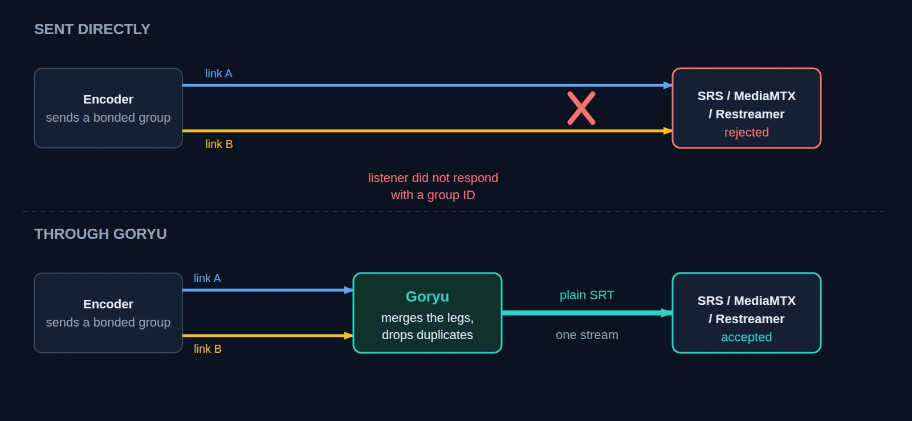

SRT bonding sends one live stream over several network links at once, for example two uplinks or two SIM cards. If one link degrades or dies, the receiver still has the data from the other, so the stream does not drop. libsrt implements it as a _socket group_.

The catch is the receiving end. A server has to accept the group, and most open source media servers cannot. We run [SRS](https://github.com/ossrs/srs) in [Bunryu](https://github.com/live-miracles/bunryu), so we wrote a small relay, [Goryu](https://github.com/live-miracles/goryu), that accepts the bonded group and forwards ordinary SRT to the server behind it. This post shows how to put it in front of SRS, MediaMTX or Restreamer, and what we actually checked.

## The problem

We sent a bonded broadcast group, two legs, straight at each server's SRT port. All three refused it. The sender's libsrt logs the reason:

```text
HS EXT: agent is a group member, but the listener did not respond with group ID. Rejecting.
```

That means the server's listener does not accept groups. The versions we tried were SRS 7.0.189, MediaMTX v1.21.2 and datarhei Core 16.16.0, which is the engine inside Restreamer. SRS has an open request for it ([ossrs/srs#4771](https://github.com/ossrs/srs/issues/4771)), so that one may change.

## The fix: terminate the group before the server



Goryu listens on one port with group connections enabled. libsrt merges the legs and drops the duplicate packets before Goryu reads anything, so Goryu sees one clean MPEG-TS stream. It then publishes that stream to your server as a normal single-link SRT caller, with the same `streamid`. The server never knows the input was bonded. An ordinary single-link SRT sender works on the same port.

## Try it with MediaMTX

Start MediaMTX, then Goryu with a config that points at MediaMTX's SRT port (`8890`):

```bash
docker run -d --network host bluenviron/mediamtx
```

```json
{
    "input_host": "0.0.0.0",
    "input_port": 10081,
    "output_host": "127.0.0.1",
    "output_port": 8890,
    "status_port": 8081,
    "passphrase": ""
}
```

```bash
curl -fsSL -o goryu.tar.gz https://github.com/live-miracles/goryu/releases/latest/download/goryu-linux-x86_64.tar.gz
mkdir goryu && tar -xzf goryu.tar.gz -C goryu
LD_LIBRARY_PATH=goryu/lib goryu/bin/goryu goryu.json
```

Now send a bonded stream to `srt://<host>:10081` with `streamid=publish:stream`, and play it back from MediaMTX:

```bash
ffplay 'srt://127.0.0.1:8890?streamid=read:stream'
```

The `streamid` is the one thing to get right, because Goryu copies it unchanged to the server. These are the publish ids we used:

| Server                     | Publish streamid              | Goryu `output_port` |
| -------------------------- | ----------------------------- | ------------------- |
| SRS                        | `#!::r=live/stream,m=publish` | `10080`             |
| MediaMTX                   | `publish:stream`              | `8890`              |
| datarhei Core / Restreamer | `stream,mode:publish`         | `6000`              |

SRS needs its SRT server enabled, and Core needs `CORE_SRT_ENABLE=true`. The [downstream servers page](https://live-miracles.github.io/projects/goryu/docs/usage/downstream-servers/) has the details and the playback ids.

## Passphrases

SRT encrypts each hop on its own. By default Goryu uses one passphrase on both: set `passphrase` and the encoder must use it, and so must the server. That is awkward when Goryu runs next to the server, because the hop that crosses the internet is the encoder's.

From v3.4.0 you can give the server side its own with `output_passphrase`: an empty string for a server without a passphrase, or a different one. Left out, it falls back to `passphrase`, so existing configs do not change.

```json
{
    "input_host": "0.0.0.0",
    "input_port": 10081,
    "output_host": "127.0.0.1",
    "output_port": 8890,
    "status_port": 8081,
    "passphrase": "a-long-secret-for-encoders",
    "output_passphrase": ""
}
```

Each passphrase must be empty or 10 to 79 characters, the range libsrt accepts, and Goryu refuses to start otherwise. We checked this against a server that enforces its passphrase: encrypted input with a plain server, a different passphrase on each side, a plain input with an encrypted server, and the default. We also checked the two cases that must fail. An empty `output_passphrase` does not fall back to the input's, so a server that still requires one is refused. A server given the input's passphrase instead of its own is refused too. Neither passphrase appears in the relay's log.

## Sending a bonded stream

This is the awkward part, and we would rather say so. FFmpeg cannot open a socket group, and libsrt's own `srt-live-transmit` takes one input and one output. `srt-test-live` from libsrt 1.5.6 failed to create a sending group when we tried it. Many encoders that advertise bonding use a vendor protocol with their own receiver instead of libsrt groups. The one hardware encoder we have confirmed sends a libsrt group to Goryu is the AJA BRIDGE LIVE, described below.

For testing without hardware, there is a 196-line test caller in the Goryu repository, `bonded_caller.c`, that sends a broadcast group with one leg per local address, and can drop, add or flap a leg, or send a main/backup group. It is what every bonded test in the project uses, and the [sending page](https://live-miracles.github.io/projects/goryu/docs/usage/sending-bonded-srt/) shows how to build and run it. If your encoder sends a libsrt broadcast group, point it at Goryu and it will work; if it speaks SRTLA or a vendor protocol, it will not, and the [alternatives page](https://live-miracles.github.io/projects/goryu/docs/getting-started/alternatives/) says what to look at instead.

## Broadcast or main/backup

libsrt 1.5 offers two group types, and the sender picks one. The receiver, Goryu, treats them the same: it merges what arrives and forwards one stream.

- **Broadcast** puts the whole stream on every link. If a link fails the others already have every packet, so nothing has to switch. The price is bandwidth: two links cost twice the data.
- **Main/backup** gives each link a weight. The heaviest link carries the stream and the others sit idle, sending only keepalives. If the main link becomes unstable the sender activates a standby. It costs one link's worth of data, which matters on metered cellular, but the switchover is its weak spot: packets sent while the main link was failing, before it was judged unstable, can be late or lost.

In Goryu's status API every leg of a broadcast group is `running`. In a main/backup group the standby is `idle`, with a receive rate of about zero.

We sent a main/backup group over loopback at 4 Mbps, with weights 10 and 5. The main leg was `running` at 4.4 Mbps and the backup `idle` at 0.000 Mbps. When we closed the main leg the backup became `running`, about 2 MB arrived in the next four seconds (roughly 4 Mbps), and the downstream never reconnected.

One catch: at a trickle (0.12 Mbps) libsrt kept both legs active, so a main/backup group needs real traffic before it settles on a main leg.

## What we saw when a leg dropped

We sent a stream through Goryu with two legs and closed the second leg nine seconds in, watching the status API:

| Time | Legs | Bytes forwarded |
| ---- | ---- | --------------- |
| 8 s  | 2    | 472,444         |
| 12 s | 1    | 708,008         |
| 16 s | 1    | 933,044         |

The leg left the `legs[]` list, the byte counter kept growing, and `outputConnected` stayed `true`. The server behind Goryu saw an unbroken stream. Each leg reports its own round-trip time, loss, retransmissions and buffer, which is what you want when you are deciding which uplink is the weak one.

## With a real encoder, over the internet

This is how we run it: Goryu in front of SRS carries our live events every day.

We pointed an AJA BRIDGE LIVE at the Goryu relay (v3.3.0) on our Bunryu server, a Google Cloud VM in Mumbai, which forwards to the SRS on the same host. AJA lists SRT bonding over the public internet as a feature from firmware v1.16 ([release notes](https://www.aja.com/pdf/2024/AJA_BRIDGE-LIVE_ReleaseNotes_v1.16.pdf)), and it needs the Annual Maintenance Option. Four minutes after the relay started, its status API showed this for the two legs:

| Per leg                   | Leg A     | Leg B     |
| ------------------------- | --------- | --------- |
| Round-trip time           | 44.0 ms   | 40.8 ms   |
| Receive rate              | 22.6 Mbps | 22.6 Mbps |
| Packets received          | 491,703   | 491,737   |
| Packets lost on this leg  | 48        | 157       |
| Retransmissions           | 8         | 208       |
| Dropped for arriving late | 0         | 0         |
| Receive buffer            | 242 ms    | 239 ms    |

- **Two full copies.** In broadcast mode each leg carries the whole stream, so both show about 22.6 Mbps. The two legs came from distinct public addresses, with 240 ms of latency.
- **Real loss, handled.** Each leg lost a small share of its packets (about 0.01% and 0.03%) and asked for retransmissions, and nothing arrived too late. Goryu reports loss per leg, not for the merged stream, so this shows how each link behaved, not what the merged stream lost.
- **Downstream.** Zero retry failures and no error on the stream.

The relay's journal covers five days. It records 18 bonded sessions and no plain ones, with no downstream retries and no failed connects. The longest session ran 21 hours 51 minutes and forwarded 215.8 GB, about 22 Mbps on average, and it ended only because the service was stopped for maintenance. These are our live events, not test runs.

## Pulling one cable

With the stream running, we unplugged one of the encoder's two LAN cables for about 45 seconds and plugged it back in, while recording the relay's status once a second. These are the samples around the event, on the VM's clock:

| Time     | Legs | Bytes forwarded | What changed                     |
| -------- | ---- | --------------- | -------------------------------- |
| 14:22:37 | 2    | 2,713,522,252   | both legs running                |
| 14:22:41 | 1    | 2,725,683,408   | one leg gone from `legs[]`       |
| 14:23:22 | 1    | 2,837,954,000   | still one leg                    |
| 14:23:27 | 2    | 2,852,886,652   | the leg is back, with no restart |

- **The stream never paused.** Between 14:22:37 and 14:23:27 the relay forwarded 139.4 MB in 50 seconds, which is 22.3 Mbps. In steady state before the pull it was 21.9 Mbps. Over the whole event `outputConnected` stayed `true`, `retryFailures` stayed 0 and no error was recorded, so SRS saw one unbroken connection.
- **The leg came back by itself.** Nobody touched Goryu or the encoder after the cable went back in. The status showed the leg absent for about 46 seconds, which matches the 45-second pull.
- **One oddity.** The rejoined leg reports 7,977 lost packets from the moment it appears. That is roughly the first 3.7 seconds of the stream at this bitrate, so it is probably the gap before the leg joined being counted as loss. We have not confirmed that, and the merged stream did not slow down.
- **Nothing in the log, in v3.3.0.** The journal has no line for the leg dropping or for it coming back. The status API shows it live, but afterwards only the counters remain. The next release, v3.4.0, logs both: one line per change with the leg's address and how many legs remain, such as `Bonded leg left streamid=... leg=<ip>:<port> legs=1`, and `Bonded leg joined ...` when it returns. A leg that flaps is limited to 12 lines per 30 seconds and then summarised, so a bad link cannot flood the journal. Bunryu writes the same changes to the pipeline's log.

## What we did not test

- **Different providers and degraded links.** The cable pull is a clean failure: the link went away and came back. The relay cannot tell whether the two paths use different providers, and we have not tested a link that degrades with heavy loss or congestion instead of disconnecting. The loopback test above is the only run that exercised a leg closing from the sender's side.
- **Switchover on a real link.** We tested both group types on loopback legs. We have not measured how many packets a main/backup switchover loses on a link that degrades before it dies, because loopback legs never do.
- **Other things worth knowing.** By default one passphrase covers both the input and the downstream connection; from v3.4.0 `output_passphrase` gives the server its own, or none. The release is Linux x86_64 only.

## Takeaways

- **Bonding needs both ends.** The receiving server is as much a part of it as the encoder, and the open source ones mostly do not accept groups yet.
- **A relay is a small, replaceable piece.** Goryu is about 2,800 lines of C and a config of six fields (a seventh is optional), so you can read all of it before trusting it with a live stream.
- **Check the sender first.** The hard part today is finding something that sends a libsrt group, not receiving it. Of the hardware we know of, the AJA BRIDGE LIVE is the one we have seen do it.

Goryu and its [documentation](https://live-miracles.github.io/projects/goryu/docs/) are open source (MIT), and we would like to hear from anyone who tries it on real links.
