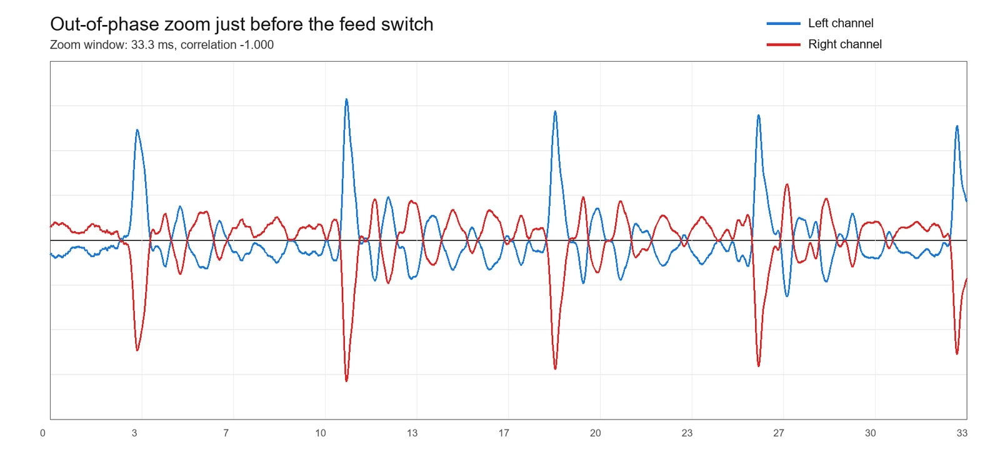
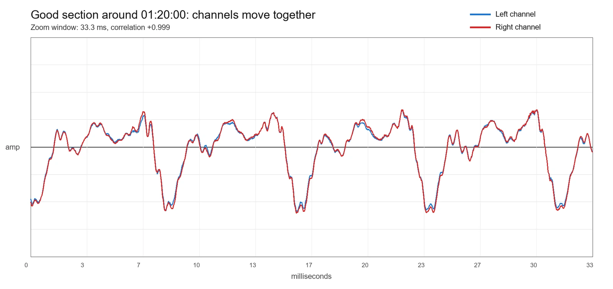
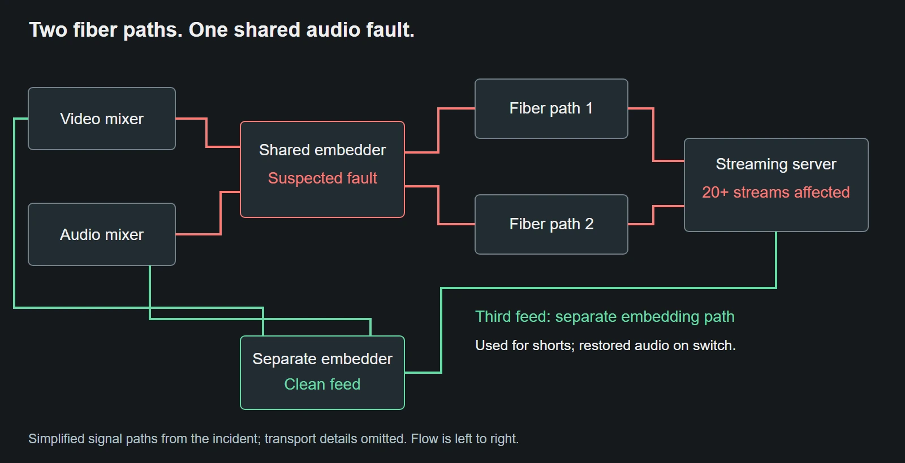
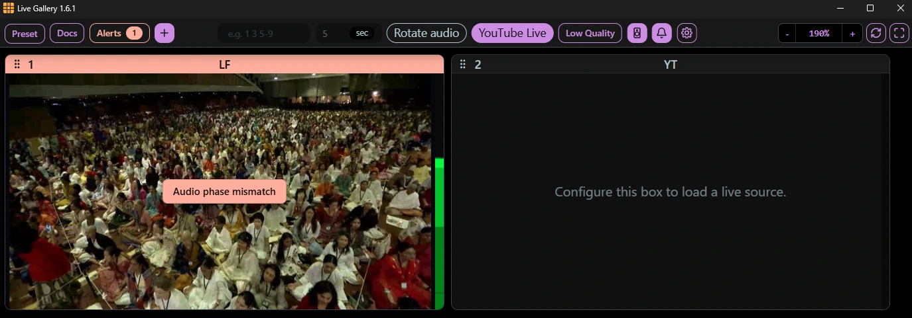

Both audio meters were moving. The dry run had gone well. We had two fiber paths from the event to the streaming server. Yet when the event went live, viewers across more than 20 streams started reporting bad, breaking audio.

Switching to the backup feed did not help. Switching to a third feed finally did, about an hour into the live event. By then, many viewers had left.

This is how one suspected faulty audio embedder affected all those streams, why our monitoring missed it, and what we changed in [Live Gallery](https://github.com/live-miracles/live-gallery) afterwards.

## The warning we did not understand

At the venue, vendors were using hardware to embed the audio and video into the outgoing feed. That device had shown signs of trouble from the beginning. We suspected a loose connection, but the vendors appeared to resolve the problem, and we did not investigate further. The dry run then went well.

We do not have a confirmed diagnosis of the hardware fault. A loose connection is one possibility, not an established cause. What became clear later was that the affected feeds shared that embedding stage, and their left and right audio channels were cancelling when combined.

## Our monitoring heard only one channel

We were monitoring the streams in Live Gallery with a mono speaker setup that, in our arrangement, let us hear only the left channel. We could also see separate volume bars for left and right. Both showed audio, and what we heard sounded acceptable, so we thought the feeds were healthy.

But listening to the left channel alone is different from listening to a mono mix of left and right. We had checked that audio was present in each channel. We had not checked whether the channels worked together.

That distinction became painful during the event. Some phones played the audio acceptably; others sounded bad or lost much of it. Headphones could sound fine too. At the time, that inconsistency made the reports harder to explain. In retrospect, it was a useful clue: the result depended on how the playback device handled the two channels.

## Why two active meters can hide bad audio

When two channels carry similar sound with opposite polarity, each channel can sound fine on its own. Their volume meters can look normal too. Trouble appears when a playback system adds them together.

A mono mix commonly combines the channels as `(L + R) / 2`. If the right channel is an inverted copy of the left, the positive parts of one meet the negative parts of the other, and the sound cancels. With partial cancellation, voices can become thin, quiet, or unstable rather than disappearing completely.

Stereo playback can keep the channels separate, so headphones may conceal the problem. Devices that combine the channels can expose it. The behavior we observed was consistent with this, although we did not verify the internal routing of every phone that viewers used.

Analysis of the recording later showed negative correlation between the channels and a loss of level when they were combined. The strength varied through the affected portion. That points to a stereo compatibility problem; it does not, by itself, tell us which physical channel or connection was at fault.

This 33.3 millisecond sample from just before the feed switch shows the problem clearly: when one channel rises, the other falls. Cancellation was not equally strong throughout the incident.

For comparison, this sample around 01:20:00, after the switch to the clean feed, shows the channels rising and falling together. Their correlation is close to +1. The key difference is their shared direction, not the height of the waveform: the two images show different moments of audio. Healthy stereo does not need to match this closely, but these channels reinforce rather than cancel each other when combined.

## The backup had the same upstream fault

Our first response was to switch fiber paths. We had two paths from the venue to the streaming server, but both carried audio from the same suspected faulty embedder. Changing the transport path could not remove a problem already present in the source.

The third feed was different. It took video from the video mixer and audio from the audio mixer through a separate embedding path. We normally used this clean feed to make social media shorts because it did not include the event overlays and lower thirds.

When we switched to that feed, the audio problem cleared. This was the recovery, about an hour after the live started. It also exposed the gap in our backup plan: the two fiber paths were separate, but a critical part of their source chain was shared.

## What we added to Live Gallery

[Live Gallery](https://github.com/live-miracles/live-gallery) is our open source, MIT-licensed Electron application for monitoring many live streams simultaneously. After this incident, we added an audio phase mismatch alert and a choice of mono or stereo listening mode.

The phase check looks at the relationship between left and right, including their correlation and how much level is lost when they are combined. It evaluates sustained evidence across multiple samples rather than treating one negative reading as a fault. We want to avoid nuisance warnings: normal stereo material can contain differences between channels, and negative correlation alone is not proof of broken equipment.

The mono listening option combines left and right so we can hear cancellation during a check. It closes the specific gap in our earlier setup, where hearing only the left channel gave us confidence that the full stereo feed was safe.

Our screenshot of Live Gallery 1.6.1 shows the phase warning directly over the playing recording, even while the channel meters show audio activity. This demonstrates the monitoring added after the incident, not an alert available during the original event.

## What these changes cannot guarantee

The alert is a warning about possible cancellation, not a diagnosis of an embedder. It cannot identify a loose cable, determine which channel was inverted, or promise that every viewer's device will sound good. Quiet passages, intermittent faults, and less pronounced cancellation may also escape detection. We prefer some missed detections to constant false alarms that operators learn to ignore.

Mono listening and phase warnings give us additional ways to notice this failure. They do not replace listening, investigating early hardware trouble, or checking which components our backup feeds share.

## What we would carry into the next event

- Check the feed in stereo and in a combined mono mix during the dry run. Left-only listening is a separate check.
- Treat moving left and right meters as evidence of signal, not evidence that the signals combine correctly.
- Trace backup feeds all the way upstream. Two transport paths can still share one faulty source device.
- Investigate an early hardware problem even when it appears to have gone away.
- Keep an independently sourced feed available, and know how to switch to it before the event starts.

The clean feed saved this event's remaining broadcast. The more lasting change was learning to test what our viewers might actually hear, including what happens when two apparently healthy channels become one.
