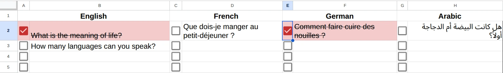
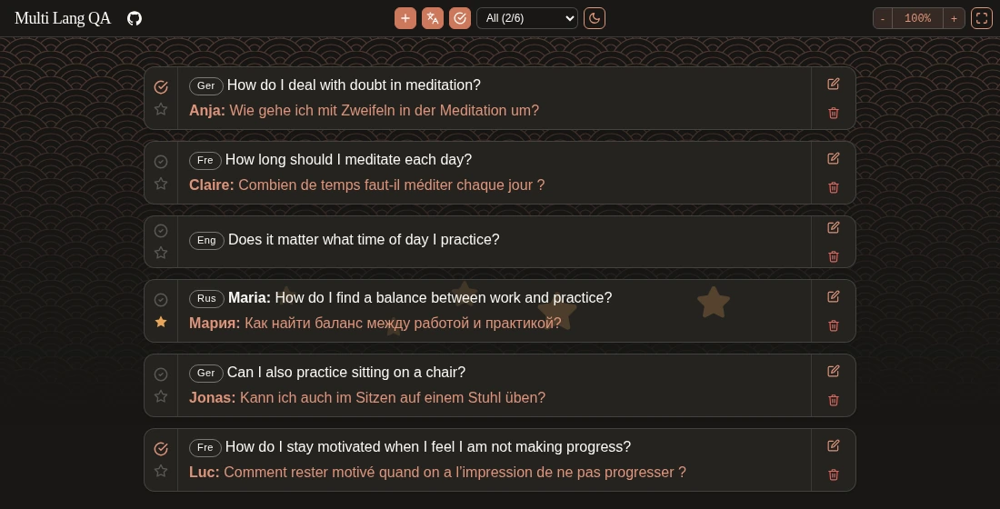
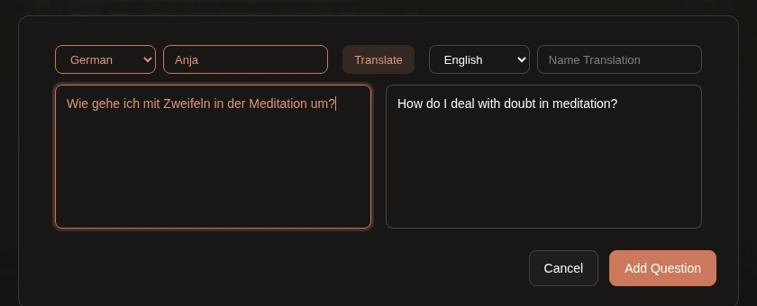
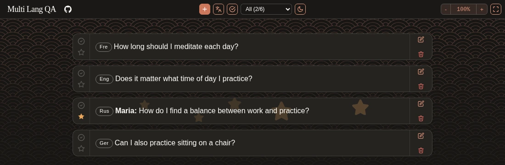

Picture a live session. The teacher speaks English, and interpreters stream it in other languages, for example German, French and Russian. Each language has its own Zoom or YouTube stream, and each stream has its own chat.

Then the teacher says, "Let's take some questions." Who reads all those chats at once?

## What we did before

We used a Google Sheet with one column per language. Volunteers pasted questions into their language's column and ticked the checkbox once a question was done.

It worked, but:

- The teacher had to scroll up and down, and also left and right, so some questions were missed.
- A question asked in German had to be translated to English before the teacher could read it. A volunteer opened a translator, pasted the question, copied the result and pasted it back.

## What we built

[Multi Lang QA](https://github.com/live-miracles/multi-lang-qa) is a small web app that runs on Google Apps Script and keeps its data in a Google Sheet. All questions go into one list, from top to bottom, with no sideways scrolling.

Sample questions. Each card shows the English translation first, with the original text and the asker's name below it.

Operators in every language open the same page and add questions at the same time. The page checks for new questions every 5 seconds, so everyone sees the same list.

### Adding a question

An operator picks the question's language, types or pastes the question and presses **Translate**. The app translates it with Google's translation service (`LanguageApp.translate` in Apps Script) and fills in the translation field. The operator can fix it by hand before adding the question, and can add the asker's name in Latin letters (for example Мария as Maria), so the teacher can read and say it.

### For the teacher

- **Done:** mark a question as completed once it has been answered.
- **Star:** star the question being discussed. The star is saved with the data, so everyone sees which question is current.
- **Hide completed questions** so that only the open ones are left.
- **Hide the original text** to see only the English translations.
- **Filter by language** to show one language only.
- **Zoom and fullscreen** to put the list on a screen that the teacher can read from a distance.

## Try it and use it

There is a [demo](https://live-miracles.github.io/multi-lang-qa/) with sample data that you can click through. Changes there are not saved, and the demo's translation is only a stand-in.

To run your own copy you need a Google account. Apps Script and Google Sheets are free, and there is nothing to host. The [README](https://github.com/live-miracles/multi-lang-qa#deploying-to-google-apps-script) has the steps: create an Apps Script project, add the two files, set your spreadsheet's ID as a script property and deploy it as a web app.

It is not limited to our setup. If you take questions from an audience in more than one language, whether on Zoom, YouTube or in a room, it may save you the same trouble.

If it is useful to you, a star on [GitHub](https://github.com/live-miracles/multi-lang-qa) helps other people find it. Issues and ideas are welcome too.
