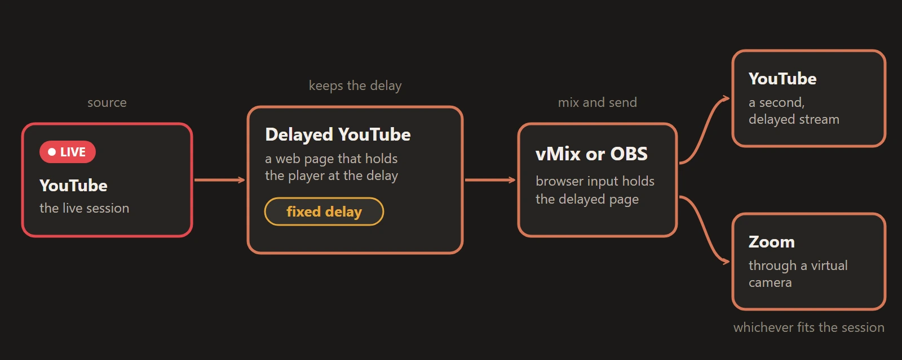

In our programs, some participants are not in the session when it starts. They join late, or an internet or power outage drops them in the middle. For them we run a separate **delayed session**: the same program, a fixed number of minutes behind, so they can watch it from the beginning. This post shows how we make that delay with vMix, what went wrong at first, and the small web page that fixed it. It is only a web page, so it works the same in OBS or any app that can embed one.

## The setup

The main session streams live to YouTube. In vMix we add that live stream as an input, but through the Delayed YouTube page instead of a plain player, so it stays a set number of minutes behind live. From there the delayed picture goes wherever the session needs it: streamed again to a second YouTube live, or into Zoom through the vMix camera. In OBS, add the page as a **Browser source** and use OBS's streaming or virtual camera.

## What we did before, and why it broke

At first we put the YouTube live link into a vMix player input and moved the playhead back by hand. That works until YouTube jumps to live, which happens when the internet buffers. It is rare, but we saw it, and if nobody is watching the input the delayed participants silently skip the part that was supposed to be delayed. It also hit several languages at the same time, since each runs its own vMix. We think the cause is mostly the network.

## The fix: a page that holds the delay

We could not stop YouTube from jumping, so we made the delay correct itself. [Delayed YouTube](https://live-miracles.github.io/delayed-yt/) is a web page with a YouTube player that watches how far behind live it is. If the player gets closer to live than it should be, the page seeks back to the configured delay.

The stream in the demo is a third-party YouTube live stream. Its content belongs to its channel.

To use it:

1. Open the page, paste the YouTube video ID or the full link, and set the delay.
2. Click **Update**. The settings are saved in the page URL.
3. Copy that URL into a vMix **Web Browser** input, an OBS **Browser source**, or the web page input of whatever app you use.

The delay is kept automatically and precisely, where before we adjusted it by hand. The player always starts full size, even after a refresh, without YouTube's recommendations around the video. If YouTube jumps to live, nobody needs to be watching: the page seeks back in about a second. In our use it works very well, with almost no problems.

## Known issues

- **It does not work in the first 30 minutes of a stream.** YouTube's player API does not report the correct duration until then. The delay must also be at least 10 minutes.
- **A jump to live still shows a few seconds of buffering** before the page seeks back. It is not seamless, only no longer lost.
- **If you stop sending the stream, the delay gets shorter**, by about the length of the break, because YouTube leaves that time out of the timeline. Refresh the delayed page and it works out the delay again. Viewers rewatch a few minutes, but without the refresh anyone who joins later gets no real delay.
- **YouTube may ask you to sign in to confirm that you are not a bot**, mostly on a new system. For us it appeared after some time of use, lasted a while and then stopped. Signing in to YouTube inside the player usually fixes it, and the vMix and OBS steps are under Known Issues on the page. The login is stored on that computer, so use an account made for streaming.

## The other way we tried: record to a file

Before the page, we recorded the live stream to a local `.ts` file, added it to vMix and set its position to the delay. We chose `.ts` because it can be played while it is still being recorded, which an MP4 cannot.

It works, but it is harder to run. The vMix setup is more complex: you record one input while the output comes from the program output, and there are many settings to get right. The file must be deleted after every session or the disk fills up, and it uses more CPU and RAM. We stopped using it and now use only the page.

## Try it

Delayed YouTube is free and open source (MIT). Open the [page](https://live-miracles.github.io/delayed-yt/) and try it with any YouTube live stream that is more than 30 minutes old, or read how it works in the [repository](https://github.com/live-miracles/delayed-yt).

If something does not work for your session type or your app, [open an issue](https://github.com/live-miracles/delayed-yt/issues/new). And if it helps you, a star on the repository helps other operators find it.
