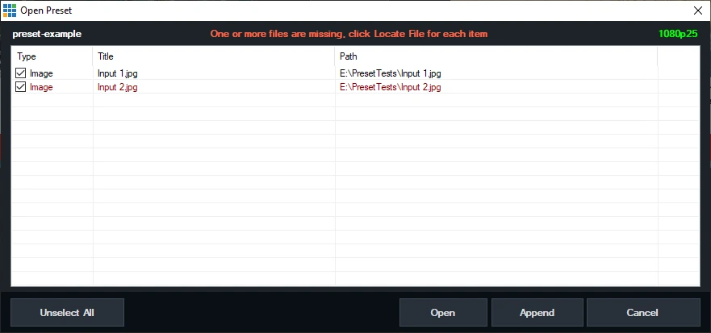
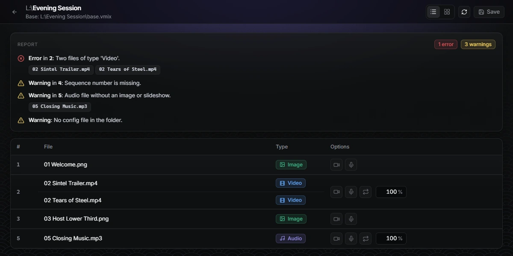

We stream live sessions in many languages. One program can run in 20 or more languages over time: a few languages one week, a different set the next. Every program has several sessions (five, six, seven), and every session has its own set of media files, which we call a kit. Kits are updated all the time.

For a long time we built the vMix preset for each session by hand. It worked, until it didn't. This post is about the two ways it failed and the small free tool we built so it can't fail that way again. If your team rebuilds a similar playlist for every event, you can reuse the method.


## Problem 1: vMix finds files by name

Three teams touch every session. The content team prepares the material, the programs team arranges it into sessions, and the technical team supports the live stream.

When the content team updated a file, the new file came back with a new name. A vMix preset finds each input by its file name, so the preset broke: an input pointing at a file that no longer existed. Someone on the technical team had to open the preset and repair it, and sometimes we only found out when a session was about to start.



## Problem 2: settings drift

A preset is not only files. Every input has audio and output settings, and they have to be the same in every preset. They weren't. Someone would switch off headphone monitoring on the microphone input by accident and save the preset. At the next session the operator could not hear the microphone, and we had to open input after input to find out why.

Hand-built presets also carry leftovers from the last program, so nothing starts clean.

## The fix: the folder is the playlist

We decided to stop editing presets and generate them. Three ideas make it work.

### 1. Number the files

The programs team puts a number at the start of every file name. The number is the playing order.


```text
01 Welcome.png
02 Teaching.mp4
03 Meditation.mp3
03 Slide.png        <- same number: shown over the audio
04 Photos           <- a folder of photos becomes a slideshow
Notes.txt           <- no number: ignored
```

Two rules do most of the work. Different numbers play one after another. The same number means "play together", for example an image shown over an audio file. Files without a number are ignored, so notes can stay in the same folder.

A new version of a file can have any name as long as it keeps its number, so renames stop breaking things.

### 2. Choose the options in a simple app, not in vMix

The programs team opens the folder in [vMix Folder Player](https://github.com/live-miracles/folder-player) and sees every item of the playlist. For each one they choose what they need: camera on or off, microphone on or off, loop, volume, and for a folder of photos how many seconds each photo stays on screen. The choices are saved in a small text file in the same folder, so they stay with the kit.


When they click **Create vMix Preset**, the app reads the files and the options and writes the preset. It also checks the folder and reports problems straight away, so the programs team can fix them before the technical team ever opens vMix. For example, here two videos have the same number, number 4 is missing, and an audio file has no image to show with it:



The same report also catches a video hidden under an overlay, a camera option when the base preset has no camera input, and more. When everything is fine, the report says there are no issues.

### 3. Start every preset from a base preset

The settings problem goes away when nobody redoes the settings. The technical team builds one **base preset**, `base.vmix`, once. It holds everything that should never change: the camera input (titled `Cam`), the microphone input (titled `Mic`), all the audio buses that need to be on, the outputs, and a black input that we use for our custom transition.

For every session the app copies the base and adds the numbered files to it, one by one. Every preset has the same settings because every preset starts from the same base, and nothing is left over from the last program. To change a setting everywhere, change the base once.


## What changed for us

- The technical team no longer repairs presets. The programs team generates them from the folder they already maintain.
- Updating a kit is safe: replace the file, keep its number, create the preset again.
- Every preset has the same microphone, headphone and bus settings, the ones in the base.
- Mistakes show up in a report before the session, not during it.
- With a parent folder that holds one folder per session, the app creates a preset for every session in one go.

## What it doesn't do

The app writes a preset that you open in vMix. It does not control vMix while you are live, and it only runs on Windows. The installer is not code-signed yet, so Windows SmartScreen may warn you the first time you run it. It also depends on your team agreeing to number the files, which is a habit, not a feature.

## Try it on your own setup

You don't need 20 languages to have this problem. If you rebuild a similar vMix playlist for every event, the same method works:

1. Make one clean `base.vmix` with your `Cam` and `Mic` inputs and your settings.
2. Number your content files in playing order.
3. Generate the preset instead of building it.

vMix Folder Player is free and open source (MIT). [Download it from the releases page](https://github.com/live-miracles/folder-player/releases/latest), read the [documentation](https://live-miracles.github.io/projects/folder-player/docs/), or [open an issue](https://github.com/live-miracles/folder-player/issues/new) if something doesn't fit your workflow. If it saves you setup time, a star on the [repository](https://github.com/live-miracles/folder-player) helps other vMix operators find it.

Demo media: Blender Foundation open movies, licensed [CC BY 3.0](https://creativecommons.org/licenses/by/3.0/) ([credits](https://github.com/live-miracles/folder-player/blob/master/assets/CREDITS.md)).
