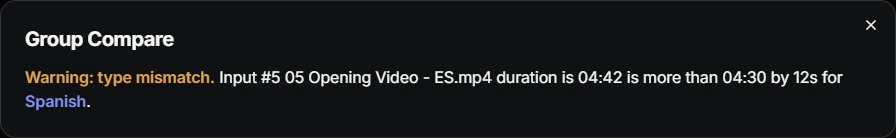

vMix runs on one computer, usually in the studio, and the person who needs to control it is not always standing next to it. A colleague wants to see what is on air. An operator has a problem with the audio. You want to know how long the current video has left.

vMix has a built-in Web Controller for this, and we tried it first. It is minimal: it shows each input as a type letter and a number, such as `V 5`, so during a live show you have to remember what `V 5` is, and it is meant for a few inputs and simple switching. We wanted the whole vMix on a web page, so we built [vMix Master](https://github.com/live-miracles/vmix-master).

## What is on the page

vMix Master is laid out like vMix itself, so it feels familiar from the first minute.

- **Program and preview** with large timers, a position slider, Restart and Play/Pause, and six transition buttons: Quick Play, Cut, Stinger 1, Stinger 2, Fade and FTB.
- **Every input by name**, with its number, its audio level, and what is on air and in preview. `05 Opening Video.mp4` instead of `V 5`.
- **A tile for each input** with overlays 1 to 6, loop, volume, and send-to-bus buttons.
- **Audio buses** with live level meters.
- **Function buttons** for most of the vMix API, grouped by what they do: outputs (external, SRT, recording, streaming), transitions, audio, overlays, playback, countdowns, titles, layers and picture, PTZ, playlists and scripts. A raw request box takes any other function.
- **Works on a phone or tablet**, and can be installed as an app from Chrome.

It needs nothing installed. It is a static page that talks straight to the Web Controller your vMix already has, from your browser, over your local network. You can try everything without vMix in the [live demo](https://live-miracles.github.io/vmix-master/?demo), which runs simulated systems inside the page.

## How we use it day to day

During a session our operators sit in the studio and the support team does not. From the same page on the local network we can open any of their systems and help without going to the room:

- If the audio is too loud, lower the volume or the gain.
- To see how long a video has left, and so how long until they go live, open that system and read the timer.
- To start or stop a stream, press the function button instead of asking someone to find it.

## A bonus: several vMix systems as one

Our setup is unusual, and this part grew out of it. We stream live sessions in English, translated into German, French, Russian, Arabic and more, and each language runs on its own vMix system with its own copy of the media. When English plays a video, every other language has to play the same video in its translated version at the same moment.

So vMix Master can group systems. Add the English, German, French and Arabic systems, put them in one group, and mark English as the **master**. Whatever you do on the master, such as a transition or an audio change, is sent to every system in the group at once.

We used the same idea at events with vertical and horizontal screens in the hall. One vMix played the vertical version of every video and another played the horizontal one, and one click switched both.

**Group Compare** checks that the systems in a group are set up alike. It matches inputs by the number at the start of their name. A different number or order on one system is an error. A video on one system and a slide on another, for the same number, is a warning about the type. The same video more than 5 seconds longer or shorter on one system is a warning too, and it also checks audio buses, call sources and overlay layers. It is how we find a missing file or a wrong translation when we prepare new content, before the session instead of during it.

For the translations themselves we later moved to a small script that runs inside vMix on each translation system and follows the English one, so those operators never need the website. The [slave scripts](https://live-miracles.github.io/projects/vmix-master/docs/) are free and live in the same repository. vMix Master is still what we use to monitor and compare the systems, and to step in when something goes wrong.

## Other options

[Bitfocus Companion](https://bitfocus.io/companion) is a good choice if you want Stream Deck style buttons and hardware surfaces. It is a separate app, and you build your own pages. OBS users have web control panels such as obs-web, and we could not find an equivalent for vMix with this much of the interface, which is why we made one.

## What it doesn't do

- It does not send a password, so a Web Controller protected by one will not work. Use it on a trusted local network.
- It has no hardware control surface support.
- It is made for Chrome, which asks once whether the page may reach devices on your local network.
- The slave scripts need vMix 4K or Pro, the editions that have scripting.

## Try it

vMix Master is free and open source (MIT). Open the [demo](https://live-miracles.github.io/vmix-master/?demo) to look around. To use it with your own vMix, enable the Web Controller in vMix (default port `8088`) and open the [hosted app](https://live-miracles.github.io/vmix-master/). The [documentation](https://live-miracles.github.io/projects/vmix-master/) explains how to connect your systems.

If something you need from a vMix control panel is missing, [open an issue](https://github.com/live-miracles/vmix-master/issues/new) and tell us. And if it helps you, a star on the [repository](https://github.com/live-miracles/vmix-master) helps other vMix operators find it.
